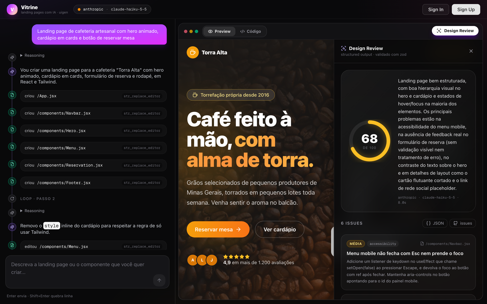

# Vitrine · landing pages com IA

Gerador de landing pages e componentes React **animados** para pequenos negócios. Você descreve o negócio do cliente; a IA cria os arquivos em loop, você vê cada passo numa timeline e o preview aparece ao vivo. Depois, um **Design Review** devolve um objeto validado (score + issues) que a aplicação consome.

Projeto da Aula 1 da Especialização em Desenvolvimento com IA (PDA), construído sobre o **UIGen** do curso da Anthropic. Material da aula: [`docs/aula1/ROTEIRO.md`](docs/aula1/ROTEIRO.md).



## O que tem aqui dentro

| Conceito | Onde |
|---|---|
| Streaming (`streamText` → `toUIMessageStream`) | `src/app/api/chat/route.ts` |
| System prompt + cache | `src/lib/prompts/generation.tsx` |
| Tools com `inputSchema` + loop agêntico (`stopWhen`) | `src/lib/tools/`, `src/app/api/chat/route.ts` |
| Structured output (`generateText` + `Output.object`) | `src/lib/review/`, `src/app/api/review/route.ts` |
| Cliente: `useChat` + `DefaultChatTransport` + `onToolCall` | `src/lib/contexts/chat-context.tsx` |
| Troca de provedor por `.env` | `src/lib/provider.ts` |
| Modelo mock (roda sem chave) | `src/lib/mock-model.ts` |

## Pré-requisitos

- Node.js 22+ (exigido pelo AI SDK 7)
- npm

## Setup

```bash
cp .env.example .env     # preencha SÓ o provedor que for usar (ou nenhum, para o mock)
npm run setup            # instala, gera o Prisma client e cria o banco SQLite
npm run dev              # http://localhost:3000
```

Sem nenhuma chave o app roda com o **modelo mock**: streaming, timeline, preview e Design Review funcionam com respostas fixas. Bom para testar a interface e para o CI.

## Provedores

Escolha com `AI_PROVIDER` no `.env`. `AI_MODEL` é opcional e sobrescreve o modelo padrão. Sem `AI_PROVIDER`, o app usa o primeiro provedor que tiver chave.

| `AI_PROVIDER` | Variável da chave | Modelo padrão | Custo | Onde pegar a chave |
|---|---|---|---|---|
| `google` | `GOOGLE_GENERATIVE_AI_API_KEY` | `gemini-flash-latest` | free tier | [Google AI Studio](https://aistudio.google.com/apikey) |
| `groq` | `GROQ_API_KEY` | `openai/gpt-oss-120b` | free tier | [console.groq.com/keys](https://console.groq.com/keys) |
| `openrouter` | `OPENROUTER_API_KEY` | `nvidia/nemotron-3-ultra-550b-a55b:free` | modelos `:free` | [openrouter.ai/keys](https://openrouter.ai/keys) |
| `anthropic` | `ANTHROPIC_API_KEY` | `claude-haiku-5-5` | pago | [console.anthropic.com](https://console.anthropic.com/settings/keys) |
| `mock` | – | `mock-uigen` | grátis, offline | – |

### Gemini (Google AI Studio)

```
AI_PROVIDER=google
GOOGLE_GENERATIVE_AI_API_KEY=sua-chave
```

Crie a chave no AI Studio com sua conta Google. Confira os termos do free tier: nele, o Google pode usar o conteúdo enviado para melhorar os produtos. Não mande dado de cliente real.

### Groq

```
AI_PROVIDER=groq
GROQ_API_KEY=sua-chave
```

É o provedor da turma. O que saber antes da aula (testado em 16/11/2026):

- **Limite: 8 mil tokens por minuto** em todos os modelos de chat do free tier (`openai/gpt-oss-120b`, `openai/gpt-oss-20b`, `qwen/qwen3.8-27b`). Uma landing de cafeteria gasta isso em uns 3 passos do loop, porque cada passo reenvia o system prompt e os arquivos já criados.
- **Por isso a landing leva de 1 a 3 minutos** no Groq (no Haiku, uns 30 s). Quando o Groq responde "limite atingido" (HTTP 429), o app espera o tempo que o Groq pede e tenta de novo sozinho (`maxRetries: 6`). Se mesmo assim não der, o chat mostra "Limite de uso do groq atingido... espere 1 minuto e mande *continue*". Os arquivos já criados não se perdem.
- **Duas proteções só para modelos abertos** (`src/app/api/chat/route.ts`): no 1º passo de um projeto novo o modelo é obrigado a chamar a ferramenta (sem isso, o gpt-oss às vezes cola o código no chat e nenhum arquivo é criado); e a ferramenta compila cada arquivo e devolve o erro de sintaxe ao modelo, que corrige no passo seguinte.
- A frase de abertura ("Vou criar...") aparece **no fim**, não no começo, por causa do 1º passo forçado.
- **Limite diário: 200 mil tokens por modelo** (dá umas 10 landings). Quando acaba, o chat avisa "cota diária". Cada modelo tem a sua cota: troque para `AI_MODEL=openai/gpt-oss-20b` ou `AI_MODEL=qwen/qwen3.8-27b` e continue.
- Cada aluno com a própria chave: o limite é por conta. Gerar, rodar o review e gerar de novo em sequência rápida é o que mais estoura o limite por minuto.

### OpenRouter

```
AI_PROVIDER=openrouter
OPENROUTER_API_KEY=sua-chave
# AI_MODEL=outro-modelo:free
```

Bom como **plano B**, não como provedor principal da turma. Comparação feita em 16/11/2026, com o mesmo prompt de cafeteria e o e2e completo:

| | Groq `openai/gpt-oss-120b` | OpenRouter `nvidia/nemotron-3-ultra-550b-a55b:free` | OpenRouter `openrouter/free` |
|---|---|---|---|
| Resultado | passou (landing + review) | passou (landing + review) | não terminou em 5 min |
| Tempo da landing | 1 a 3 min | ~4 min 20 s | – |
| Passos do loop | 6 a 9 | 10 | ficou reeditando o `/App.jsx` |
| Limite do free tier | 8 mil tokens/min e 200 mil tokens/dia **por modelo** | 20 req/min e **50 requisições/dia** por conta | idem |
| Landings por dia, por aluno | ~10 por modelo (dá para trocar de modelo) | ~4 (cada passo é uma requisição) | – |

`openrouter/free` sorteia um modelo gratuito **a cada chamada**, então cada passo do loop pode cair num modelo diferente. O terminal mostra isso em `[chat] modelos usados: ...`. Para um agente em loop, prefira um modelo fixo.

Os modelos `:free` entram e saem do catálogo. Para listar os gratuitos que aceitam *tool calling* (chamada de ferramentas), sem o qual o loop não funciona:

```bash
curl -s https://openrouter.ai/api/v1/models | jq -r '.data[] | select((.id | endswith(":free")) and (.supported_parameters | index("tools"))) | .id'
```

Para ver quantas requisições gratuitas ainda restam hoje: `curl -s https://openrouter.ai/api/v1/key -H "Authorization: Bearer $OPENROUTER_API_KEY" | jq .data.free_model_daily_requests`. Comprar 10 créditos uma vez sobe o limite para 1000 por dia.

### Como testar a troca de provedor

1. Edite `AI_PROVIDER` (e a chave) no `.env`. O `next dev` recarrega o `.env` sozinho; recarregue a página.
2. O **badge no topo** mostra `provedor · modelo`. Vermelho = configuração errada (passe o mouse para ver o motivo).
3. Gere uma landing e rode o Design Review. O terminal loga `[chat] provedor/modelo`, `[chat] fim: <motivo> · <passos> · <tokens>` e `[review] provedor/modelo`.
4. Rode o e2e contra o provedor: `E2E_PROVIDER=google npx playwright test` (troque pelo provedor que quiser).

Cada aluno usa a própria chave: a cota é por conta/projeto. **Nunca** commite o `.env` (ele já está no `.gitignore`).

## Testes

```bash
npm test                 # unitários (vitest)
npm run lint
npm run build
npm run test:e2e         # Playwright com o mock: fluxo completo, roda no CI
npm run test:e2e:real    # mesmo fluxo com o Haiku (usa ANTHROPIC_API_KEY do .env), fora do CI
```

Na primeira vez: `npx playwright install chromium`. O Next 16 só aceita um `next dev` por pasta, então pare o `npm run dev` antes do e2e.

## Design Review

`POST /api/review` com `{ files }` (o sistema de arquivos virtual serializado) devolve:

```ts
{ review: { score: number, summary: string, issues: ReviewIssue[] }, provider, modelId }
```

O schema está em `src/lib/review/schema.ts`, junto com `reviewToIssues(review)`, que formata cada issue como `{ title, body, labels }` para abrir no GitHub (usado na Aula 2).

## Stack

Next.js 16 (App Router) · React 19 · TypeScript · Tailwind CSS v4 · `motion` · AI SDK 7 · Zod 4 · Prisma + SQLite · Monaco · Vitest + Testing Library · Playwright

## Origem

Baseado no **UIGen**, projeto do curso *Claude Code in Action* da Anthropic. Migrado para Next 16 / AI SDK 7 e estendido para a aula (UI, Design Review, multi-provedor, mock, e2e e material didático).

> **Sobre licença:** o código original do UIGen foi distribuído pelo curso sem licença open source explícita. Este repositório é material educacional e não adiciona uma licença própria; os direitos sobre o código original continuam com a Anthropic. Use para estudo.
